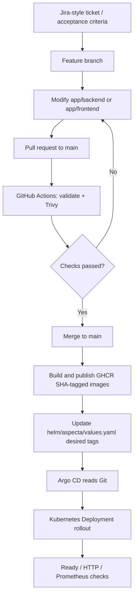

# Aspecta: change, versioning and release playbook

> **Current deployment model (October 2026):** application images are tagged `sha-<full Git commit SHA>` and published to GHCR; the Aspecta Helm chart is sourced **directly from Git** by Argo CD. A separate OCI chart release process and a formal `app/VERSION` are **not implemented**. This document describes what actually exists, with optional practices clearly marked.

## 1. Three independent version identities

| Identity | Current example | File or owner | When it changes |
| --- | --- | --- | --- |
| **Container image tag** | `sha-e15e721956a10a8657296e3096b42245dffafa5d` (last observed) | GHCR image + image refs in `helm/aspecta/values.yaml` | When CI builds/publishes from an application-source commit and promotion updates desired tags |
| **Aspecta Helm chart version** | `0.1.1` | `helm/aspecta/Chart.yaml`, `version` | When we intentionally version chart templates/defaults/contracts; **not** needed for an image-only rollout |
| **Chart `appVersion` metadata** | `0.1.0` | `helm/aspecta/Chart.yaml`, `appVersion` | When a **separate application release/version** is actually declared; not for every SHA-tagged image |
| **Third-party Helm chart version** | Prometheus chart `92.2.0`, metrics-server `3.14.0`, sealed-secrets `2.20.0` | `gitops/apps/*.yaml` `targetRevision` | When we upgrade that specific add-on after reviewing compatibility |
| **Bootstrap Helm chart version** | Argo CD `10.10.1`, Traefik `41.6.1` | Helm installs plus bootstrap/chart pins | When infrastructure bootstrapping or an explicitly planned infrastructure upgrade changes |
| **Git desired state revision** | `main` | Argo CD Application `targetRevision` | Git commits to values, templates or platform config; no new image required for a pure YAML change |

`Chart.yaml version` and `appVersion` **do different jobs**. Changing the image tag does not automatically change either version field. Since the current chart is consumed from **Git**, Argo CD can deploy template/value changes even without a chart-version bump; bumping `version` on meaningful chart changes is good release discipline. If we later publish versioned chart packages, each published chart change needs a distinct package version.

**Current product version policy:** no formal application SemVer is maintained yet. Use the Git commit SHA/image digest as the precise deployed-artifact reference. `appVersion: 0.1.0` is existing metadata, not proof of a release image named `v0.1.0`. A semantic application `0.1.1` would require an explicit release decision and tagging process, not just editing `Chart.yaml`.

## 2. Which file changes for which ticket?

| Change or ticket | Typical edit | New Docker image? | Bump app chart `version`? | New add-on `targetRevision`? |
| --- | --- | :---: | :---: | :---: |
| Backend API feature or bug fix | `app/backend/**` | **Yes** | No | No |
| Frontend feature, CSS, UI logic | `app/frontend/**` | **Yes** | No | No |
| Update which image is deployed | `helm/aspecta/values.yaml` image tag | No new build **if image exists** | No | No |
| Change replica policy/HPA, resources, probes or ingress | `helm/aspecta/values.yaml`, maybe `templates/**` | Usually no | Recommended for chart definition change | No |
| Change Kubernetes RBAC/NetworkPolicy | `helm/aspecta/templates/**` | No | Recommended | No |
| Change validation, scanner, build flags or promotion code | `.github/workflows/publish-images.yml`, `.github/scripts/promote-images.py` | Only if the workflow deliberately rebuilds | No | No |
| Upgrade kube-prometheus-stack | `gitops/apps/monitoring.yaml`; perhaps `platform/monitoring/values-minikube.yaml` | No app rebuild | No | **Yes**, monitoring chart |
| Upgrade Metrics Server / Sealed Secrets controller | Corresponding `gitops/apps/*.yaml` | No app rebuild | No | **Yes**, that chart |
| Upgrade Argo CD / Traefik bootstrap chart | Bootstrap/chart pins and `platform/*` Helm values | No app rebuild | No | Not via app GitOps; test upgrade separately |
| Update CSI StorageClass | `platform/storage/csi-hostpath-wffc.yaml` | No | No | No; inspect PV/PVC compatibility **before** change |
| Documentation-only change | `README.md`, `docs/**` | No | No | No |

**One practical warning:** CI promotion updates backend **and frontend** desired image tags together in the current workflow. A single backend code change can therefore result in both image tags referencing the same source commit even if frontend logic did not change. Verify the exact workflow triggers before interpreting tags as independent semantic component versions.

## 3. Release flow 1: application code -> Docker -> GitOps



Small runbook (replace example branch and ticket IDs):

```bash
# Developer: branch, change, validate and push
 git switch main && git pull --ff-only origin main
 git switch -c feat/ASPECTA-101-backend-message
 # Edit app/backend/server.js, then:
 docker build -t aspecta-backend:dev ./app/backend
 helm lint ./helm/aspecta
 git add app/backend && git commit -m 'feat(api): improve hello response'
 git push -u origin feat/ASPECTA-101-backend-message
 gh pr create --base main --fill

# After PR checks pass and the PR is merged:
 gh run list --workflow publish-images.yml --branch main --limit 5
 kubectl --context aspecta -n aspecta-app get deployments -o wide
 kubectl --context aspecta -n argocd get application aspecta
```

Confirm GHCR visibility, published image SHA/digest, promotion commit, Argo CD Diff and eventual `/api/hello` response. A successful PR scan **does not** prove an image was published from `main`; publishing happens later and is conditional. The workflow may skip jobs when only documentation/chart config changed.

**Rollback:** revert the change to the desired Git image tag or application manifest by a reviewed PR; do not manually overwrite the Deployment and fight Argo CD. Validate that old GHCR tags are still available. Hold/inspect automatic CI promotion if it could immediately overwrite the rollback.

## 4. Release flow 2: Helm configuration only (no image rebuild)

Example: adjust CPU requests or a readiness probe via chart values/templates. This is a GitOps change; the image remains the same.

```bash
 git switch main && git pull --ff-only origin main
 git switch -c fix/ASPECTA-102-backend-probes
 # Edit helm/aspecta/values.yaml or helm/aspecta/templates/backend-deployment.yaml
 helm lint ./helm/aspecta
 helm template aspecta ./helm/aspecta --namespace aspecta-app > /tmp/aspecta-rendered.yaml
 git diff --check
 git add helm/aspecta && git commit -m 'fix(chart): adjust backend readiness settings'
 git push -u origin fix/ASPECTA-102-backend-probes
 gh pr create --base main --fill
```

After merge, check the Argo CD Diff and Deployment rollout. If a template/defaults contract changed, bump the chart `version` for traceability. Changing *only an existing image tag* in `values.yaml` does **not** require a new chart version. Do not assume `helm upgrade` is required: Argo CD renders the chart from Git.

## 5. Release flow 3: GitHub Actions pipeline change

Example: adjust Trivy policy, job conditions, matrix, Docker build flags, or promotion script. This does not inherently alter the deployed app.

1. Create `ci/ASPECTA-103-...` branch and edit `.github/workflows/publish-images.yml` or `.github/scripts/promote-images.py`.
2. Validate YAML and the promotion script (`python -m py_compile .github/scripts/promote-images.py`). Review `on` / `paths` filters, `if`, `needs`, permissions, and `workflow_dispatch`.
3. Open PR and inspect **which jobs actually ran**: `changes`, `validate`, `scan`, `publish`, `promote-gitops`. A skipped publishing job on PR is expected.
4. Merge only after acceptable checks. Run a **deliberate test** of the affected path; a green lint check alone does not establish promotion works.
5. Check GHCR and `helm/aspecta/values.yaml` only if the change intentionally triggers a build/promotion.

Note: a push created using `GITHUB_TOKEN` generally will not fire a second push workflow. Promotion updates desired state in Git; Argo CD reconciles without an additional image build.

## 6. Release flow 4: upgrade a platform Helm add-on

Example: upgrade kube-prometheus-stack, not the Aspecta application chart.

1. Read upstream release notes and **Kubernetes/CRD compatibility**; ensure PVC and storage safety.
2. Create `chore/ASPECTA-104-monitoring-upgrade`, change `targetRevision` in `gitops/apps/monitoring.yaml` and adjust the referenced Git values if required.
3. Verify exact sources and new versions (Argo CD Helm charts may not show in `helm list -A`):

```bash
 kubectl --context aspecta -n argocd get application aspecta-monitoring -o yaml
 kubectl --context aspecta -n monitoring get pods,pvc
 kubectl --context aspecta get storageclass aspecta-csi-wffc
```

4. PR/review/merge; inspect Argo CD Diff (especially CRDs, StatefulSets, volumes, RBAC), then allow/perform a controlled sync.
5. Verify Prometheus/Alertmanager readiness, metrics targets, relevant alerts and PVC binding. If an upgrade changes storage layout or CRDs, design a rollback/migration plan *before* rollout. **No app image rebuild or app chart bump is necessary.**

The same principle applies to Metrics Server and Sealed Secrets: update the **particular add-on chart**. Argo CD chart version `targetRevision` is separate from the Git source's `targetRevision: main` in a multi-source Application.

## 7. Storage ownership changes (infrastructure + GitOps)

The CSI HostPath **driver** is owned by the first-install infrastructure flow; the
`aspecta-csi-wffc` **StorageClass** is an Argo CD resource. Do not move the
CSI driver itself under Argo CD just to simplify a dashboard.

1. Change the bootstrap/storage helper (only after reviewing PVC classes).
2. If changing the default StorageClass annotation or the WFFC contract, edit
   `platform/storage/csi-hostpath-wffc.yaml` and run a GitOps Diff before syncing.
3. In the existing lab, run `aspecta-env.sh storage reconcile` during maintenance.
4. After merging to `main`, sync `aspecta-storage` and require `storage status --strict`.
5. Check both `Bound` monitoring PVCs and `7/7 Synced / Healthy` in Argo CD.

Changing StorageClass metadata does not relocate existing PVCs. Changes to CSI
provisioner identity, volume binding, or PVC templates require a separate migration
plan; never delete a Bound PVC as part of housekeeping.

## 8. Operating and demonstrating a change

For every ticket record: **Goal -> files changed -> release identity -> validation -> rollout -> verification -> rollback**. A short operations evidence template:

| Evidence | Example |
| --- | --- |
| Ticket | `ASPECTA-101` – return a backend field |
| Branch / PR | `feat/ASPECTA-101-backend-message`, PR URL |
| Build / validation | GitHub Actions run URL, Trivy scan result |
| Artifact | GHCR image tag and ideally OCI digest |
| Desired state | Commit modifying `helm/aspecta/values.yaml` or a chart template |
| Live state | Argo CD `Synced / Healthy`, Pod Ready, `/api/hello` HTTP 200 |
| Rollback | Git revert of the intended source change, with image retention verified |

Quick health commands:

```bash
 bash scripts/aspecta-env.sh verify
 kubectl --context aspecta -n argocd get applications
 kubectl --context aspecta -n aspecta-app get deployments,pods,hpa -o wide
 kubectl --context aspecta -n monitoring get pods,pvc
```

**The scope of this assignment:** one Minikube control plane; local CSI HostPath is not HA storage; one replica during normal operation can briefly interrupt service during a rollout. Do not promise zero-downtime failover. New full clusters need their own Sealed Secrets keys.

See [Repository and GitOps map](REPOSITORY-AND-GITOPS-MAP.md), [Stack and versions](STACK-AND-VERSIONS.md), [CI/CD details](CI-CD-AND-DEVELOPMENT-FLOW.md), and [Operations lifecycle](OPERATIONS-LIFECYCLE.md).
