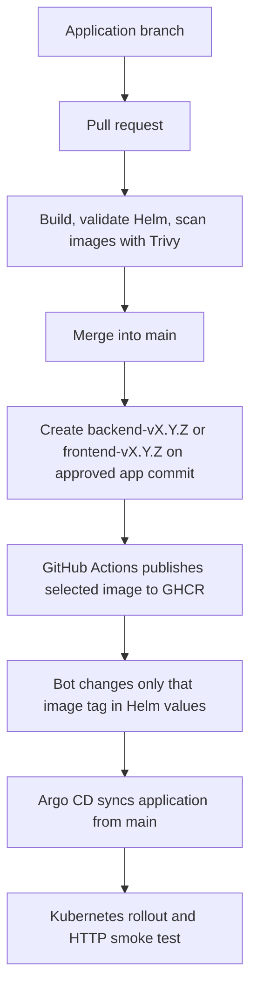

# CI/CD – from code to a running Pod



| Event | CI checks | Publish image | GitOps promotion |
|---|---|---|---|
| Docs-only PR/push | **No** app workflow | No | No |
| App/Helm/CI PR | Yes (Trivy for app/CI changes) | No | No |
| App/Helm/CI push into `main` | Validation; scans according to changes | No | No |
| `backend-v0.1.1` tag | Yes, scans both components | Backend only | Backend tag only |
| `frontend-v0.1.1` tag | Yes, scans both components | Frontend only | Frontend tag only |
| Platform-only PR | **No** app workflow | No | See [D](operations/D-PLATFORM.md) |

Both services have independent versions and share one Helm chart. GitHub Actions also builds a **temporary Helm chart package** during validation; it doesn't push that chart to a separate registry. The release promotion edits the chart's `values.yaml` in Git. Argo CD then reconciles Kubernetes.

**Example:** fixing only backend means a new `backend-v0.1.1` release while frontend remains at `v0.1.0`. See [Application steps](operations/A-APPLICATION.md). For config-only changes use [Helm/GitOps](operations/C-HELM-GITOPS.md); for infrastructure/add-on upgrades use [Platform](operations/D-PLATFORM.md).

```bash
# Check desired state and actual deployed images after a release:
git pull --ff-only origin main
kubectl -n argocd get applications
kubectl -n aspecta-app get deployment aspecta-backend aspecta-frontend \
  -o custom-columns=NAME:.metadata.name,IMAGE:.spec.template.spec.containers[0].image
```

`Synced / Healthy` is useful, but also test `/` and `/api/hello` through Traefik. A workflow success does not by itself prove that the new image is running.
