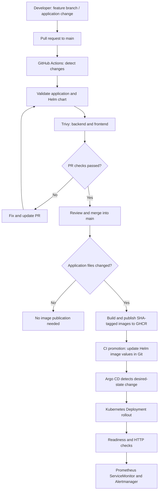
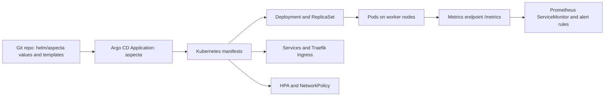

# Aspecta: Development, Docker, CI/CD and GitOps flow

> Purpose: explain the **end-to-end release path** for developers and reviewers. Source of truth: `.github/workflows/publish-images.yml`, `.github/scripts/promote-images.py`, `helm/aspecta/`, and `gitops/`. Recheck workflow conditions on the branch being evaluated before assuming a particular job runs.

## 1. End-to-end picture



**Ownership boundary:** GitHub Actions builds and publishes artifacts; Argo CD continuously reconciles **desired manifests in Git**; Kubernetes Deployment/ReplicaSet controllers keep the requested Pods running. A deleted Pod is usually recreated by Kubernetes even if Argo CD does nothing.

## 2. Docker images: from source to running process

| Layer | Backend | Frontend |
| --- | --- | --- |
| Source | `app/backend/server.js` | `app/frontend` source and assets |
| Docker build context | `./app/backend` | `./app/frontend` |
| Build strategy | Small distroless Node.js 22 Debian 13 runtime | Multi-stage: `node:22-alpine` builds assets; `nginxinc/nginx-unprivileged:stable-alpine` serves final assets |
| Runtime account | UID/GID 1000, no root | Unprivileged NGINX (UID 101 in tested image) |
| Example endpoint | `/healthz`, `/readyz`, `/api/hello` via ingress, `/metrics` | `/` through Traefik |
| Output artifact | `ghcr.io/jansoltys9/aspecta-backend:sha-<commit>` | `ghcr.io/jansoltys9/aspecta-frontend:sha-<commit>` |

The frontend build-stage image and build tools **do not have to be included in the final runtime image**. The backend uses a distroless runtime, so a normal shell is not available for `kubectl exec`; debug with logs, Kubernetes events, probes and an explicitly authorized ephemeral debug container when appropriate.

Both containers are configured with non-root and restrictive Kubernetes security settings (read-only root filesystem, dropped capabilities, security context). Verify the actual template files for exact values, and keep the exposed port consistent across Dockerfile, container port and Service.

### Local build and chart validation

```bash
docker build --pull -t aspecta-backend:dev ./app/backend
docker build --pull -t aspecta-frontend:dev ./app/frontend
helm lint ./helm/aspecta
helm template aspecta ./helm/aspecta --namespace aspecta-app > /tmp/aspecta-rendered.yaml
```

For the **single-node reviewer demo**, render with `--set observability.enabled=false` because the full monitoring CRDs are not installed in that mode.

## 3. GitHub Actions jobs (NOT Jenkins-style stages)

GitHub Actions organizes its pipeline into **jobs** and **steps**. The workflow uses job dependencies (`needs`) and conditional execution. Backend and frontend jobs use a matrix; this produces separate checks on a PR.

| Job ID | Visible job name (simplified) | Responsibility | Runs when |
| --- | --- | --- | --- |
| `changes` | Detect application changes | Determine whether `app/**` or relevant CI files changed; controls expensive stages | Matching workflow runs; `workflow_dispatch` can bypass filtering |
| `validate` | Validate application and Helm | Code/dependency checks and Helm lint/render/package | PR and other matching workflow triggers |
| `scan` | Trivy HIGH/CRITICAL – backend/frontend | Build images for scanning without publishing; fail on fixable HIGH/CRITICAL vulnerabilities | Application / relevant CI change or manual workflow |
| `publish` | Publish GHCR – backend/frontend | Build and push full-commit-SHA-based tags, with provenance/SBOM configuration | Eligible push to main (or explicitly allowed branch) with app change; **not PR** |
| `promote-gitops` | Promote images to GitOps | Update desired image references in the Helm values file and commit them to the deployment branch | After successful publish |

**Security gate:** the Trivy job is configured to fail on HIGH/CRITICAL findings that the selected policy treats as fixable (`ignore-unfixed: true`). This is **not** a claim of zero vulnerabilities of every severity. The job must pass before a normal image publication.

**Pull request behavior:** validation/scanning can run, while publishing and GitOps promotion are skipped. Documentation-only PRs can legitimately show *no checks* if no workflow path filter matches — this happened during the AppProject naming/documentation PR. A green PR check does not mean a production image was published.

**Main-branch behavior:** on an application change, the publish job authenticates to GHCR using the scoped `GITHUB_TOKEN`, publishes backend/frontend images tagged `sha-<full commit SHA>` (the tag is a release label; inspect the registry digest for exact artifact identity), and the promotion job updates `helm/aspecta/values.yaml`. Argo CD then detects the resulting desired-state change. Check current workflow `if`/branch/path conditions before relying on this in a release demonstration.

**Important limitation:** a GitHub Actions bot commit made with the default `GITHUB_TOKEN` normally does **not** trigger another push workflow; this prevents many accidental loops, but downstream workflows cannot be assumed to run on such commits automatically. Argo CD independently polls or receives a refresh and does not require a second build.

## 4. GitOps: desired state versus actual state



Argo CD project separation:

- `aspecta-management`: root App-of-Apps (`aspecta-root`).
- `aspecta-workloads`: application (`aspecta`) and encrypted-secret Application (`aspecta-secrets`).
- `aspecta-platform`: monitoring, metrics-server, storage and Sealed Secrets controller.

The ingress controller and CSI driver are bootstrap dependencies, even though application Ingress and StorageClass resources are GitOps-managed. The CSI HostPath addon must explicitly be **enabled**; the legacy Minikube storage addons remain **disabled**. The GitOps-managed `aspecta-csi-wffc` is the intended default for new full-lab PVCs.

**Auto-Sync:** the `aspecta` Application has automatic synchronization with `selfHeal: true` and `prune: false` in the observed lab. A new Git commit updates desired state; Argo CD reconciles it. `prune: false` avoids automatically deleting removed resources. It does **not** prevent individual Kubernetes controllers from removing/replacing Pods during normal rollout.

## 5. Common development and operations scenarios

### A. Change backend code -> new image

1. Create a feature branch; modify `app/backend/server.js` and add/adjust tests.
2. Test locally; commit and push; open a PR against `main`.
3. Verify `validate` and Trivy jobs; resolve failures; review the Diff.
4. Merge the PR into `main`.
5. Check the main-branch publish run, GHCR SHA-derived tag and digest and `promote-gitops` commit.
6. Check Argo CD `aspecta` shows the desired revision and a healthy rollout; smoke-test `/api/hello`.
7. Confirm `/metrics` target and alert-rule status in Prometheus.

### B. Change Helm template/values without rebuilding the image

1. Change `helm/aspecta/templates/` or appropriate chart values in a PR.
2. Run `helm lint` and `helm template`; inspect rendered YAML and potential HPA/NetworkPolicy effects.
3. Merge after validation. Argo CD observes the Git change and applies manifests.
4. **Do not assume a new Docker image is published**: the workflow intentionally separates image changes from chart-only changes.
5. If rollout fails, revert the Git change and allow Argo CD to restore the prior desired state.

### C. Upgrade a platform chart

1. Edit the pinned chart version (`targetRevision`) in the relevant `gitops/apps/*.yaml` and, if needed, platform values.
2. Read release notes / CRD implications; validate compatibility with Kubernetes.
3. PR, review, merge; inspect Argo CD Diff and reconcile the platform Application.
4. Check add-on health and dependent workloads. Avoid `Force`, `Replace` and `Prune` without understanding data impact.

### D. Failure recovery versus GitOps drift

- **Pod deleted:** Deployment/ReplicaSet usually recreates it. This is Kubernetes self-healing.
- **Git-managed resource modified by hand:** Argo CD detects drift and may restore it when `selfHeal` is enabled.
- **Minikube power cycle:** system and application containers restart as nodes come back. Startup readiness gates validate recovery but do not impose a strict sequential Pod start order.
- **PVC problem:** check CSI driver, PV/PVC binding, scheduling and node storage before changing any manifest.

## 6. Release verification commands

```bash
# Git and latest Actions runs
git branch --show-current
git log -1 --oneline
gh run list --workflow publish-images.yml --branch main --limit 5

# Actual workloads
kubectl --context aspecta -n aspecta-app get deploy,pods,hpa -o wide
kubectl --context aspecta -n argocd get applications

# Platform and storage readiness
bash scripts/aspecta-env.sh storage status --strict
bash scripts/aspecta-env.sh verify
kubectl --context aspecta get pvc -A

# Application through Traefik (after starting a port-forward separately)
curl -f http://127.0.0.1:18080/
curl -f http://127.0.0.1:18080/api/hello
```

## 7. What the lab does *not* claim

- No multi-control-plane production availability: Minikube full mode has one control-plane node.
- No production-grade distributed storage: CSI HostPath is for local testing.
- No zero-downtime guarantee with a single application replica; HPA minimum is currently one.
- No automatic fresh-cluster full GitOps bootstrap: Argo CD installation and Sealed Secrets re-encryption remain guided steps.
- No independent verification yet of Linux/macOS installation, even though scripts are designed for portability.

For the folder layout and application hierarchy see [Repository and GitOps map](REPOSITORY-AND-GITOPS-MAP.md). For specific version-bump rules and ready-to-use ticket examples see [Change and release guide](CHANGE-AND-RELEASE-GUIDE.md). For precise versions see [Stack and versions](STACK-AND-VERSIONS.md). For local startup/shutdown see [Operations lifecycle](OPERATIONS-LIFECYCLE.md).
