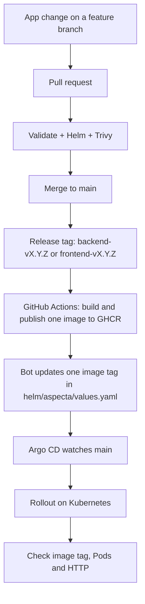

# CI/CD: code to Kubernetes

A developer pushes *source code*. GitHub Actions builds the release images; Argo CD deploys what the Git repository requests.



| Event | Validation/Trivy | GHCR publish | GitOps promotion |
|---|---|---|---|
| App pull request | Yes | No | No |
| Ordinary push / merge to `main` | Validation (scans according to changes) | No | No |
| `backend-v0.1.1` tag | Yes | **Backend only** | Backend image tag only |
| `frontend-v0.1.1` tag | Yes | **Frontend only** | Frontend image tag only |

The release workflow scans **both** components, but publishes only the one named in the Git tag. It publishes `vX.Y.Z` and `sha-<commit>` tags for that component. The promotion commit includes `[skip ci]` to avoid a second CI run. **Do not put a release tag on that bot commit**; choose the merged app change instead.

There is one Helm chart for both services; each image has its **own** version. For exact branch names and commands, use [A – Application](operations/A-APPLICATION.md).

**Check after release:**

```bash
git pull --ff-only origin main
kubectl -n argocd get application aspecta
kubectl -n aspecta-app get deployment aspecta-backend aspecta-frontend \
  -o custom-columns=NAME:.metadata.name,IMAGE:.spec.template.spec.containers[0].image
```

A green GitHub Actions run is not the same thing as a healthy Deployment. Also test the app through Traefik; see [Daily use](OPERATIONS-LIFECYCLE.md).
