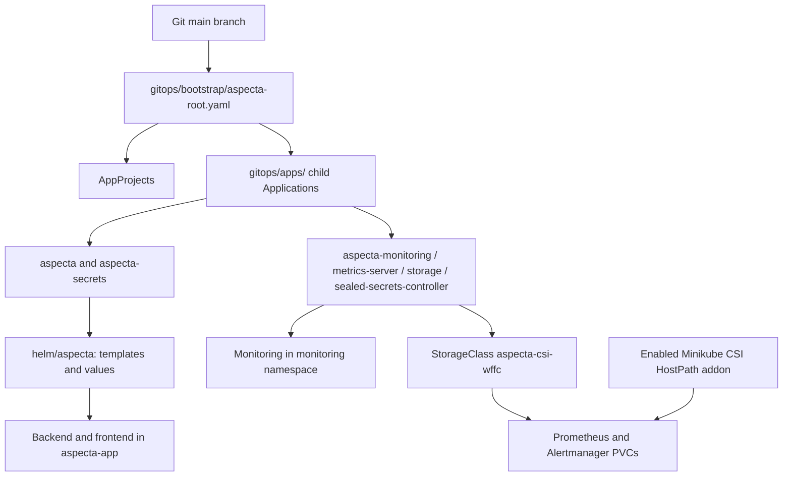

# Aspecta repository map and GitOps architecture

> **Audience:** reviewers, developers and operators. **Reference:** the repository layout used in October 2026. This is an annotated map of the relevant tracked paths, not a claim that every generated file is shown. To inspect the exact current tree, run `git ls-files`.

## 1. Where to look

```text
aspecta-k8s-assignment/
├── .github/
│   ├── workflows/
│   │   └── publish-images.yml       # GitHub Actions CI, security, GHCR, promotion
│   └── scripts/
│       └── promote-images.py        # Update desired backend/frontend tags in values
├── app/
│   ├── backend/                     # Node.js API, Dockerfile, application source
│   └── frontend/                    # Web UI, build assets and Dockerfile
├── helm/
│   └── aspecta/
│       ├── Chart.yaml               # Application chart metadata (chart version)
│       ├── values.yaml              # Config and GitOps image references
│       └── templates/               # K8s workloads, services, ingress, HPA,
│                                    # RBAC, network policies and monitoring CRs
├── gitops/
│   ├── bootstrap/
│   │   └── aspecta-root.yaml        # Entry point: App-of-Apps Application
│   ├── apps/                        # Child Applications and AppProjects
│   └── secrets/
│       └── aspecta-backend-auth-gitops.yaml  # SealedSecret (cluster-bound)
├── platform/
│   ├── argocd/                      # Initial Argo CD Helm configuration and chart pin
│   ├── bootstrap/                   # Node placement / label helper
│   ├── monitoring/                  # Prometheus/Alertmanager Helm values
│   ├── storage/                     # GitOps-managed StorageClass manifest
│   └── traefik/                     # Ingress controller Helm values and chart pin
├── scripts/
│   ├── aspecta-bootstrap.sh         # FIRST installation: demo/full, phased
│   ├── aspecta-env.sh               # EXISTING full lab: start, verify, check, stop
│   ├── aspecta-uis.sh               # Port-forward helpers for browser/API UIs
│   └── aspecta-storage.sh           # Full-lab CSI addon setup and validation
├── docs/
│   ├── BOOTSTRAP-MODES.md            # What demo and full modes install
│   ├── FULL-LAB-SECRETS.md          # Re-sealing secrets on a new cluster
│   ├── OPERATIONS-LIFECYCLE.md      # Startup gates and daily recovery
│   ├── STACK-AND-VERSIONS.md        # Deployed components and version inventory
│   ├── CI-CD-AND-DEVELOPMENT-FLOW.md # Detailed delivery/pipeline flow
│   ├── REPOSITORY-AND-GITOPS-MAP.md # This guide
│   ├── CHANGE-AND-RELEASE-GUIDE.md  # Common tickets, release/version rules
│   └── labs/                        # Security/network test manifests
└── README.md                        # Short reviewer-facing entry point
```

Do not confuse the two roots: `platform/` holds *infrastructure configuration*, while `gitops/` describes *what Argo CD should deploy*. A platform value file may be referenced by a multi-source Argo CD Application without being a Helm release installed via the Helm CLI.

## 2. GitOps objects and ownership



### Root and child Applications

| Git source | Live Argo CD Application | AppProject | Responsibility |
| --- | --- | --- | --- |
| `gitops/bootstrap/aspecta-root.yaml` | `aspecta-root` | `aspecta-management` | Bootstraps the App-of-Apps tree; root is applied initially by the operator |
| `gitops/apps/aspecta.yaml` | `aspecta` | `aspecta-workloads` | Render `helm/aspecta` into `aspecta-app` |
| `gitops/apps/aspecta-secrets.yaml` | `aspecta-secrets` | `aspecta-workloads` | Apply encrypted application secret |
| `gitops/apps/monitoring.yaml` | `aspecta-monitoring` | `aspecta-platform` | kube-prometheus-stack chart + Git values |
| `gitops/apps/metrics-server.yaml` | `aspecta-metrics-server` | `aspecta-platform` | Metrics Server chart |
| `gitops/apps/storage.yaml` | `aspecta-storage` | `aspecta-platform` | `StorageClass aspecta-csi-wffc` **only**, not the CSI driver |
| `gitops/apps/sealed-secrets-controller.yaml` | `sealed-secrets-controller` | `aspecta-platform` | Sealed Secrets controller chart |

The three AppProjects in `gitops/apps/project-*.yaml` restrict sources/destinations according to their purpose. The built-in Argo CD `default` project can exist but is not used by these Aspecta Applications.

**Bootstrap order:** Kubernetes API + networking and CSI -> initial Argo CD and Traefik -> root App-of-Apps -> platform add-ons / StorageClass -> application. Argo CD sync waves can help during **installation** but do not force order when restarting an already existing Minikube cluster. For daily power cycles use `bash scripts/aspecta-env.sh start`, then `verify` when needed.

## 3. Storage ownership: one selected provisioner

- **The selected provider is Minikube `csi-hostpath-driver`**, kept as an explicitly **enabled** infrastructure addon. Its `CSIDriver` is `hostpath.csi.k8s.io`; the CSI DaemonSet and sidecars must pass readiness checks. The driver is **not installed through Helm**.
- **Old `storage-provisioner` / `default-storageclass` Minikube addons remain disabled**. The `storage-provisioner` Pod was not a Job. A leftover `standard` StorageClass does not mean that old provisioner is active.
- **Argo CD `aspecta-storage` owns the sole Aspecta storage contract:** `aspecta-csi-wffc` with `WaitForFirstConsumer` and `is-default-class: "true"`. The old `standard` and addon example `csi-hostpath-sc` can remain as non-default class objects; both are demoted by `aspecta-storage.sh reconcile`, without deleting PVCs.
- **The monitoring Helm chart owns its PVC templates**; only `aspecta-csi-wffc` is requested by the Prometheus and Alertmanager PVCs. Their bound volumes are not modified during storage reconciliation.
- **Maintenance guard:** `scripts/aspecta-storage.sh` refuses to retire the old provider if a PVC uses a different StorageClass. The existing cluster needs the one-time `reconcile` action because the CSI resources existed while the addon was disabled. This step may re-apply addon objects, so run it deliberately.

```bash
# Existing full lab: read-only, then one controlled alignment
bash scripts/aspecta-env.sh storage status
bash scripts/aspecta-env.sh storage reconcile
# After merging GitOps changes to main and syncing aspecta-storage:
bash scripts/aspecta-env.sh storage status --strict
kubectl --context aspecta get storageclass,pvc -A
```

This CSI HostPath test driver is **not** highly available or durable production storage. For EKS, select a suitable managed CSI driver (for example EBS CSI) through an infrastructure provisioning mechanism, then manage its StorageClasses as declared desired state.

## 4. First installation versus daily operations

| Task | Entry point | Makes changes? |
| --- | --- | --- |
| First 1-node reviewer demo | `aspecta-bootstrap.sh --mode demo --phase infra`, then `--phase app` | Creates a local cluster and demo app; local Secret generated |
| First 3-node full environment | `aspecta-bootstrap.sh --mode full --phase infra`, then `--phase gitops` | Guided staged installation; re-sealing required for a new controller |
| Start existing full lab | `aspecta-env.sh start` | Starts existing Minikube profile; restores node labels; checks readiness and CSI addon ownership |
| Validate existing full lab | `aspecta-env.sh verify` | Read-only health gates, including CSI addon state |
| Align full-lab storage once | `aspecta-env.sh storage reconcile` | Enables CSI addon, disables legacy addons, demotes old defaults; never deletes PVCs |
| Stop existing full lab | `aspecta-env.sh stop` | Stops port-forwards and Minikube; keeps Kubernetes objects/PVCs |
| Open local UIs | `aspecta-uis.sh start`, then `open` | Local port-forwards only |

The shell scripts are authored in **English** and designed for Windows Git Bash, Linux and macOS, but the full end-to-end installation has only been exercised in the documented local Windows environment. Each reviewer should check installed tool versions and available resources first.

## 5. Navigation and troubleshooting

```bash
# Enumerate the REAL tracked repository files
 git ls-files
# Show chart content and render it without applying anything
 helm lint helm/aspecta
 helm template aspecta helm/aspecta -n aspecta-app > /tmp/aspecta-rendered.yaml
# Application state and platform versions
 kubectl --context aspecta -n argocd get applications
 kubectl --context aspecta -n aspecta-app get deploy,svc,ingress,hpa
```

See [Stack and versions](STACK-AND-VERSIONS.md), [Development and CI/CD flow](CI-CD-AND-DEVELOPMENT-FLOW.md), [Change and release recipes](CHANGE-AND-RELEASE-GUIDE.md), and [Operations lifecycle](OPERATIONS-LIFECYCLE.md).
