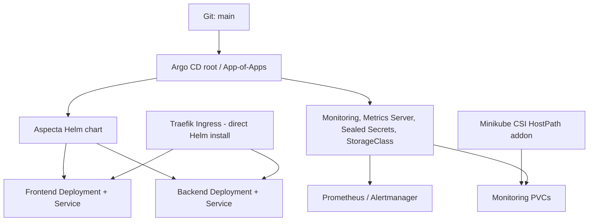

# Architecture and repository map

The repo holds the app, its Helm configuration, the GitOps desired state and local platform bootstrap files. **The Git repository is the source of truth** for Argo CD-managed workloads.

```text
aspecta-k8s-assignment/
├── app/backend/ and app/frontend/  Application source and Dockerfiles
├── .github/workflows/           GitHub Actions
├── .github/scripts/             Image promotion script
├── helm/aspecta/                App chart, values.yaml and templates
├── gitops/bootstrap/            Argo CD root Application
├── gitops/apps/                 Child Applications and AppProjects
├── gitops/secrets/              Encrypted Sealed Secret
├── platform/                    Argo CD, Traefik, monitoring, storage config
├── scripts/                     Bootstrap, daily lifecycle, UI helpers
└── docs/                        Setup, daily use, operations A/B/C/D
```

## How GitOps is organised



| Resource | Owner | How it changes |
|---|---|---|
| App Deployments, Services, Ingress, HPA, RBAC, NetworkPolicy | Argo CD (`aspecta`) | Change `helm/aspecta/**`, merge into `main` |
| Monitoring, Metrics Server, Sealed Secrets controller, StorageClass | Argo CD child Applications | Change `gitops/apps/**` or referenced values |
| Traefik and Argo CD itself | Direct, pinned Helm releases | Planned Helm upgrade; see [D](operations/D-PLATFORM.md) |
| CSI HostPath driver | Minikube addon | Local storage helper; **not** an Argo CD Helm release |

Argo CD uses `main` and `helm/aspecta` for the application. It can reconcile a changed `values.yaml` **without rebuilding** Docker images. Helm CLI's historical `helm list` record for Aspecta is not the main app's GitOps source of truth.

**Security:** Calico NetworkPolicies control app traffic, RBAC limits the auditor's permissions, and Sealed Secrets provides the full-lab auth Secret. **Limits:** local CSI storage and a single-node demo are not production HA.
