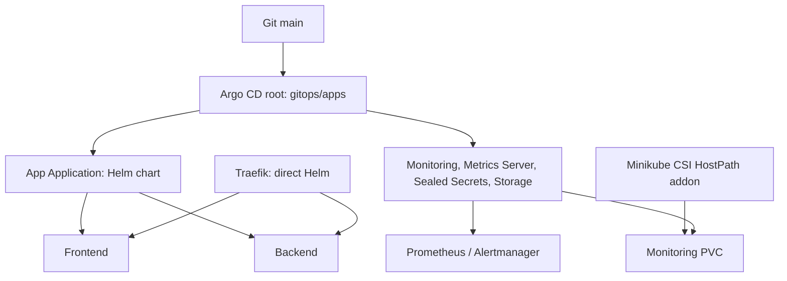

# Repository and GitOps map

```text
aspecta-k8s-assignment/
├── app/{backend,frontend}/       Code and Dockerfiles (A)
├── .github/{workflows,scripts}/  CI/CD (B)
├── helm/aspecta/                Application chart and image tags (C)
├── gitops/bootstrap/            Root Argo CD Application
├── gitops/apps/                 AppProjects and child Applications (C/D)
├── gitops/secrets/              Encrypted Sealed Secret
├── platform/                    Argo CD, Traefik, monitoring, storage (D)
├── scripts/                     Bootstrap and daily helpers
└── docs/                        Setup and short A/B/C/D playbooks
```



| Area | Managed by | Change path |
|---|---|---|
| App Deployments, Services, HPA, policies | Argo CD `aspecta` (auto-sync) | `helm/aspecta/**` |
| Monitoring, Alertmanager and other GitOps add-ons | Argo CD child Applications | `gitops/apps/**`, `platform/monitoring/**` |
| Root list of Applications | Argo CD `aspecta-root` (**manual sync**) | `gitops/apps/**` |
| Argo CD and Traefik releases | **Direct Helm**, not self-managed by Argo CD | `platform/argocd/**`, `platform/traefik/**` |
| CSI HostPath driver | Minikube addon/helper | `scripts/aspecta-storage.sh` |

**Important:** the root Application watches `gitops/apps/` but has no automated `syncPolicy`. When you change a child Application definition such as `gitops/apps/monitoring.yaml`, merge the PR and then **Sync `aspecta-root` in the Argo CD UI**; the child can then auto-sync. In contrast, a change to monitoring `values-minikube.yaml` alone is picked up by the already-running child.

For real examples and branches use [Operations](OPERATIONS.md). For first-time installation use [Bootstrap modes](BOOTSTRAP-MODES.md). Full lab uses local storage (not production-grade HA); secrets must be encrypted with the destination cluster's Sealed Secrets certificate.
